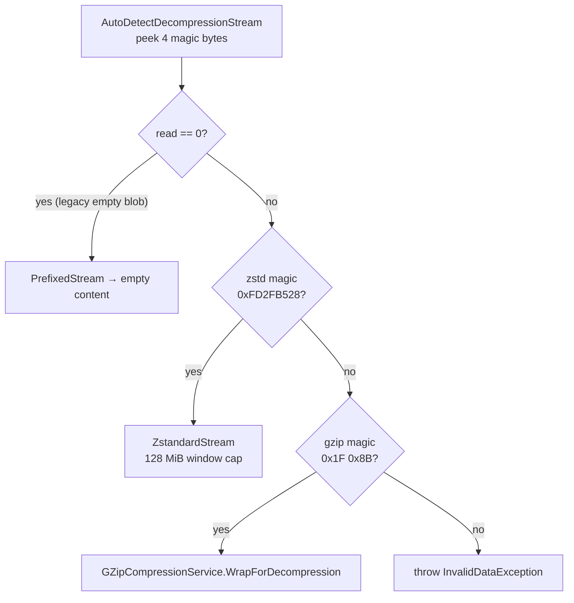

# Compression

> **Code:** `src/Arius.Core/Shared/Compression/*`  ·  **Decisions:** [ADR-0012](../../../decisions/adr-0012-zstd-as-new-compression-algorithm.md), [ADR-0024](../../../decisions/adr-0024-framework-zstandard-codec.md)  ·  **Terms:** [chunk](../../../glossary.md#chunk)

## Purpose

The compression boundary that all blob bodies pass through. `ICompressionService` wraps a stream with a codec layer the same way `IEncryptionService` does, so feature handlers and serializers stay codec-agnostic. New blobs are always written as zstd; the read path is self-describing and transparently decodes both new zstd and legacy gzip frames.

## How it works

`ICompressionService` exposes two stream-wrapping methods:

- `WrapForCompression(destination)` returns a write-only stream that compresses into `destination`; disposing it finalizes the frame.
- `WrapForDecompression(source)` returns a read-only stream that decompresses from `source`.

`ZstdCompressionService` is the only registered implementation (`ServiceCollectionExtensions` binds it as a singleton). It writes RFC 8878 zstd frames via the framework's `ZstandardStream` and owns a static `GZipCompressionService` instance to which it delegates legacy reads.

The write path uses quality 15 (`DefaultCompressionLevel`, the only ratio/speed setting). It adds the content checksum. It uses the window size from the quality level and does not use long-distance matching. It compresses with one thread. The decoder window limit stays at the framework default of 128 MiB. [ADR-0024](../../../decisions/adr-0024-framework-zstandard-codec.md) gives the deployment notes and the evidence.

The read path never consults blob metadata. `WrapForDecompression` returns an `AutoDetectDecompressionStream` that, on first read, peeks 4 bytes, then routes:

The peeked bytes are replayed via a `PrefixedStream` so the chosen decoder sees a complete frame (the magic is "un-peeked"). `read == 0` maps to empty content because the legacy gzip era wrote empty payloads as 0-byte blobs.

**No verification on upload.** [`ChunkStorageService`](./chunk-storage.md) sends the data through compression and encryption. It does not decode the output or hash the source again. It trusts the earlier chunk hash and assumes that sources do not change ([ADR-0024](../../../decisions/adr-0024-framework-zstandard-codec.md)). Golden-file tests and recovery-script tests cover encoder compatibility. Reads still use checksums and truncation checks.

## Key invariants

- **New blobs are zstd; old gzip blobs stay readable forever.** The read path must remain self-describing (magic-byte detection), never dependent on content-type or external metadata.
- **A frame written today is restorable by a default-configured reader.** Window size and long-distance matching stay at zstd's level-derived defaults, kept under the decompressor's 128 MiB `ZSTD_d_windowLogMax` cap — no large-window/LDM frames.
- **Checksums are on. Each stream uses one compressor.** The framework has no worker-count option. Check its single-thread behavior again when you upgrade the runtime.
- **Sources must not change during an archive run.** Arius does not detect a change between hashing and upload.
- **0-byte source ⇒ empty content**, not a format error (legacy empty-payload compatibility).

## Why this shape

[ADR-0012](../../../decisions/adr-0012-zstd-as-new-compression-algorithm.md) records the format choice. [ADR-0024](../../../decisions/adr-0024-framework-zstandard-codec.md) changed the provider and removed the round-trip check on upload. The stream-wrapping `ICompressionService` boundary exists to keep codec mechanics out of the storage, filetree, snapshot, and chunk-index serializers — mirroring `IEncryptionService` so the two layers compose as `compress → encrypt` on write and `decrypt → decompress` on read.

> Note: ADR-0012's prose cites level 19; the code default is currently 15. The level is a tunable performance knob — treat the code constant as authoritative and any change as a measured performance decision (per the ADR).

## Open seams / future

- **Codec is a repository-wide singleton** (one per provider). Adding a third codec, or making the write codec configurable per repository, would mean extending the magic-byte detection table and the DI registration — the boundary already supports it.
- **No write path for gzip in production.** `GZipCompressionService.WrapForCompression` exists only to keep the legacy codec a complete, testable unit; if it is ever truly dead, it can be dropped without touching the read path.
