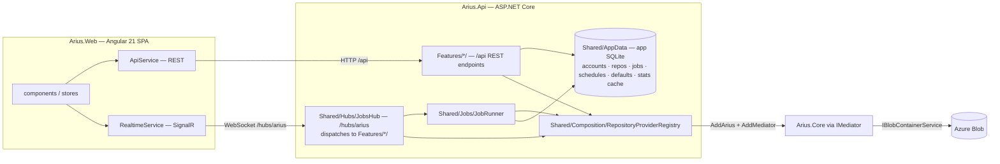
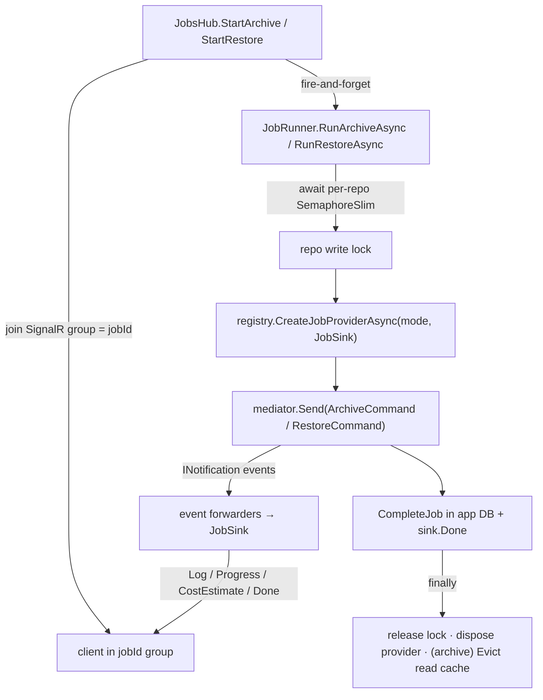
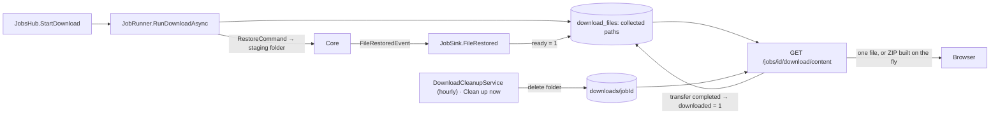
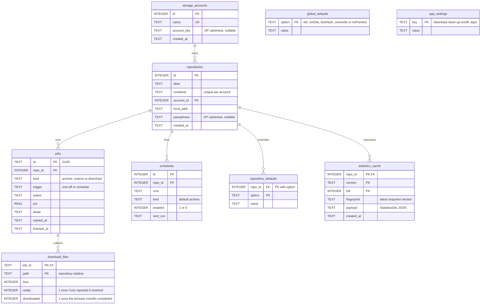

# Web host (Arius.Api + Arius.Web)

> **Code:** `src/Arius.Api/` · `src/Arius.Web/`  ·  **Decisions:** [ADR-0013](../../decisions/adr-0013-core-host-separation.md) · [ADR-0010](../../decisions/adr-0010-use-feature-handlers-for-application-use-cases.md) · [ADR-0020](../../decisions/adr-0020-provider-agnostic-cost-estimation.md) · [ADR-0025](../../decisions/adr-0025-archive-restore-defaults-hierarchy.md) · [ADR-0026](../../decisions/adr-0026-browser-downloads-staged-by-a-download-job.md)  ·  **Terms:** [snapshot](../../glossary.md#snapshot) · [chunk index](../../glossary.md#chunk-index) · [chunk](../../glossary.md#chunk) · [storage tier hint](../../glossary.md#storage-tier-hint) · [filetree](../../glossary.md#filetree)

## Purpose

The browser front-end to Arius: a multi-repository manager that runs **archive**, **restore**, **download**, **ls/browse**, **statistics**, and **scheduling** against many repositories through one server. `Arius.Api` (ASP.NET Core minimal API) is the host that drives `Arius.Core` via `IMediator` and relays Core's progress events to the browser; `Arius.Web` (Angular SPA) is the client. They are **one deployable web application** — `Arius.Api` serves the built SPA from `wwwroot` and exposes REST under `/api` plus a SignalR hub at `/hubs/arius`, so they ship as a single container. (User-facing usage lives in [guide/web-ui.md](../../guide/web-ui.md); operator/deploy in [guide/deployment.md](../../guide/deployment.md).)

Unlike the CLI and Explorer hosts, this host adds a layer Core has no concept of: it manages a **fleet** of repositories and accounts in its own SQLite database, serializes long-running mutating work into **jobs**, and lets the user confirm the **estimated restore cost** before money is spent. Everything below the `IMediator` boundary is the same Core the CLI drives — see [ADR-0013](../../decisions/adr-0013-core-host-separation.md).

## How it works

### Two projects, one application



`AriusApiHost.AddAriusApi()`/`MapAriusApi()` (`src/Arius.Api/AriusApiHost.cs`) wires the whole host — extracted from `Program.cs` as extension methods so a test host can reuse the identical pipeline (see [testing](../cross-cutting/testing.md#the-apiweb-scripted-fake-core-harness)); `Program.cs` itself now only calls them: it registers the app database, `SecretProtector`, the Azure adapters via `AddAzureBlobStorage()` (the `IBlobServiceFactory` the registry uses, plus the cost estimator — which is only meaningfully resolved inside the per-repo providers, since it needs a container's [region](../core/shared/cost.md)), the per-repo `RepositoryProviderRegistry` (behind `TryAddSingleton<IRepositoryCoreComposer, AzureRepositoryCoreComposer>()`, so a host that pre-registers a different composer wins), the `JobRunner`, the `SchedulerService`, SignalR (camelCase payloads), CORS for the dev `ng serve` origin (`http://localhost:4200`), then static-file serving for the SPA. Routes split cleanly so client-side SPA routes never collide with the server: REST lives under `/api`, the hub under `/hubs/arius`, and `MapFallbackToFile("index.html")` serves the Angular app for everything else. An `/api`-group endpoint filter stamps every response with an `X-Arius-Version` header (`AriusVersion.Display`), CORS-exposed so the dev SPA can read it cross-origin.

<a id="api-layout"></a>
**Layout: vertical slices** ([ADR-0027](../../decisions/adr-0027-api-vertical-slices.md)). `Arius.Api` follows the same Features/Shared split as Core:

| Folder | Contents |
|---|---|
| `Features/<Area>/` | One folder per capability. Each REST endpoint is one `IEndpoint` class that owns its route and its handling, with its request and response records in `<Endpoint>Dtos.cs`. Each SignalR hub method is one `IHubHandler` class. An area also holds its background services and Core event forwarders. |
| `Shared/` | What more than one area needs. |

- `Shared/Hubs/JobsHub` defines the SignalR contract and forwards each call to its `IHubHandler`; it contains no logic.
- `Shared/Hosting/FeatureRegistration` finds endpoints and hub handlers by assembly scan, so a new feature file needs no registration. It tags each endpoint with its area, so the OpenAPI document (served with the Scalar UI in Development only) groups operations by area.
- Endpoints return their DTO or a typed `Results<…>` union instead of a bare `IResult`, so the OpenAPI document describes every response.
- `AriusApiHost` and `JobsHub` are the only composition roots that may reference every area. `ApiArchitectureTests` enforces that areas do not depend on each other, that `Shared` does not depend on `Features`, and that the Api reaches Core only through `IMediator` ([testing](../cross-cutting/testing.md#architecture-tests-as-contract-enforcement)).

The SPA is a standalone-component Angular 21 app (Metronic/KTUI + Tailwind 4 — Metronic ships as **vendored** compiled assets under `public/assets/`, referenced from `angular.json` `styles`/`scripts`, not as an npm dependency; `MetronicInitService` and the `kt-init` directive only re-initialise KTUI's JS for DOM added dynamically) with lazy-loaded feature routes (`app.routes.ts`: `overview`, `repos/:repoId/{files,statistics}`, `jobs`, `settings`, the add/create wizards). Two thin core services own all server traffic: `ApiService` (typed `HttpClient` over `/api`) and `RealtimeService` (`@microsoft/signalr` over `/hubs/arius`). `proxy.conf.json` forwards `/api` and `/hubs` to the .NET host during dev. `ApiService.getAppVersion()` reads that header (off `/api/health`) for the version badge in the rail.

### Per-repository service provider

Core registers everything as singletons **scoped to one repository** (one account / container / passphrase). The web host therefore cannot use a single global Core container — it manages many repositories at once. `RepositoryProviderRegistry` builds one `IServiceProvider` per repository on demand, each with its own `IMediator` + Core service graph: `BuildAsync` always runs `services.AddMediator()` itself (the forwarders below are auto-registered in this assembly), then delegates the rest to an injected `IRepositoryCoreComposer` (`Shared/Composition/IRepositoryCoreComposer.cs`). Production wires `AzureRepositoryCoreComposer`, which opens the real container and calls `services.AddAzureBlobStorage(); services.AddArius(blobContainer, passphrase, account, container)` — the same composition as before, just behind a seam a test host can swap (see [testing](../cross-cutting/testing.md#the-apiweb-scripted-fake-core-harness)). `AddAzureBlobStorage()` supplies *this* provider's `IStorageCostEstimator`, bound to the repository's `IBlobContainerService` so it prices against the container's own [region](../core/shared/cost.md) metadata. Connection material is loaded from the app DB and decrypted via `SecretProtector` just-in-time (`LoadConnection`).

Providers that are bound to a repository have **two lifetimes**, and this distinction is load-bearing:

- **Read providers** (`GetReadProviderAsync`) — long-lived, cached per repo (`Dictionary<long, Lazy<Task<ServiceProvider>>>` behind a lock), built `PreflightMode.ReadOnly`. They warm Core's [chunk index](../../glossary.md#chunk-index) / [filetree](../../glossary.md#filetree) / [snapshot](../../glossary.md#snapshot) caches across requests, so repeated browse/stats/search calls don't re-hit Azure. They get an **inert** `JobSink` (no `JobId`), so the event forwarders fire harmlessly into nothing.
- **Job providers** (`CreateJobProviderAsync`) — a **fresh** provider per long-running archive/restore, wired to that job's own `JobSink`, owned and disposed by the `JobRunner`. A dedicated provider isolates the job's events (its own `IMediator`) and avoids reusing a chunk index that becomes single-shot after `FlushAsync`.

A third provider is not bound to any repository. It serves Core requests that need no repository, such as the container picker's `ContainerNamesQuery` (`StreamContainers`). `IRepositoryCoreComposer.ComposeWithoutRepository` registers its services; in production that is only the blob service factory. Its lifetime is described in [service lifetimes](../cross-cutting/service-lifetimes.md).

A read provider is **evicted and disposed** (`Evict`) whenever its repository's connection material or content might have changed: on a properties `PATCH`, a delete, and after every archive job (the snapshot moved, so cached read state is stale). The same three triggers also clear the repository's [statistics cache](#statistics-cache) — the two invalidations are deliberately co-located so a stale snapshot can never survive in either.

A freshly created repository has no blob container until its first archive creates one (archive preflights `ReadWrite`). The three read paths that build a `ReadOnly` provider before that point — `GET /repos/{id}/snapshots`, `/stats`, and `JobsHub.StreamEntries` — catch `PreflightException(ContainerNotFound)` and degrade to an empty result rather than surfacing a 500 (mirroring `RepositoryEndpoints.TryGetAccountInfoAsync`). `GetReadProviderAsync` also evicts a build that faulted for *any* reason, so a transient failure doesn't poison the cache and get replayed on every call until an unrelated properties-change/delete happens to evict it.

Both provider lifetimes route Core's `ILogger<T>` output to a **per-repository rolling log file** — the same `~/.arius/{account}-{container}/logs/` directory the CLI writes to — via a shared logger factory cached in the registry (`GetOrCreateRepoLoggerFactory`); anything with no repository context (host startup, the schedulers, the registry's own lines) goes to an app-wide file beside the app DB instead. So every Web-launched operation (queries *and* jobs) is captured on disk in the CLI's line format, not just on the API console. The logger's lifetime is deliberately **decoupled** from the providers: it is registered as an externally-owned singleton, so neither `Evict` nor a job disposing its provider closes the repo's log — only `DisposeAsync` at app shutdown, or a repository **delete** (`Remove`, which evicts the provider *and* disposes the logger), does. Because that delete closes a file other work may still be resolving loggers from, `DELETE /repos/{id}` returns **409** while a job is active, and a per-repository lifecycle generation voids an in-flight provider build that would otherwise re-cache a factory behind the delete. See [cross-cutting/logging.md](../cross-cutting/logging.md#which-web-file-an-event-lands-in).

### The job model

Long-running work is modelled as a **job**: a GUID, a row in the app DB (`jobs` table), a SignalR group, and a fresh Core provider. The hub starts a job and returns its id immediately; the actual run is fire-and-forget on `JobRunner`.



**Per-repository serialization.** `JobRunner` holds a `ConcurrentDictionary<long, SemaphoreSlim>` of per-repo locks (`LockFor`). Every archive and restore `await`s its repo's lock before opening a provider and releases it in `finally`. This guarantees **two mutating jobs never share a repository's on-disk Core state** (the chunk-index SQLite cache, the disk filetree cache) — concurrency across *different* repositories is unrestricted. The cron `SchedulerService` enqueues archive jobs through the same `JobRunner`, so a scheduled run and a manual one on the same repo also serialize.

**JobSink** is the per-job channel to the client. It is registered as a singleton **inside the job's own provider**, so when Core publishes a notification the auto-registered forwarder resolves *exactly this job's* sink — events are isolated **by provider, not by correlation id**. The sink sends `Log`, `Progress`, `Done` and, for restore, `CostEstimate` messages to the job's group, and aggregates the job's counters into each `Progress` snapshot (`BuildSnapshot`).

### Core → Api → SignalR → SPA event flow

Core knows nothing about SignalR. Long-running handlers publish `INotification` progress events through their `IMediator` ([overview §3](../README.md), [ADR-0013](../../decisions/adr-0013-core-host-separation.md)); the web host subscribes by implementing `INotificationHandler<T>` **forwarders** that the Mediator source generator auto-registers in every provider (`Features/Archive/ArchiveForwarders.cs`, `Features/Restore/RestoreForwarders.cs`). Each forwarder maps one Core event to a console log line + a progress update on the sink. The restore **cost handshake** uses a different mechanism: it is not an event but a `Func<…>` callback (`RestoreOptions.ConfirmRehydration`) the handler `await`s, so it can block the restore until the user answers.

```mermaid
sequenceDiagram
    participant SPA as SPA (DrawerStore / RealtimeService)
    participant Hub as JobsHub
    participant Run as JobRunner
    participant Core as Arius.Core (RestoreCommandHandler)
    participant Sink as JobSink

    SPA->>Hub: invoke StartRestore(repoId, …)
    Hub->>Hub: Groups.AddToGroup(connId, jobId)
    Hub-->>SPA: jobId
    Hub->>Run: RunRestoreAsync(…)  (fire-and-forget)
    Run->>Run: await repo lock
    Run->>Core: mediator.Send(RestoreCommand{ ConfirmRehydration })

    Core->>Core: Publish(SnapshotResolvedEvent)
    Note over Core,Sink: forwarder resolves THIS job's sink
    Sink-->>SPA: Log "Resolved snapshot …"  (group=jobId)
    Core->>Core: Publish(TreeTraversalCompleteEvent)
    Sink-->>SPA: Log + Progress(10%)

    rect rgb(255,248,230)
    Note over Core,SPA: cost handshake — restore has a non-zero estimated cost
    Core->>Run: await ConfirmRehydration(estimate)
    Run->>Sink: Cost(estimate)
    Sink-->>SPA: CostEstimate  → cost modal
    SPA->>Hub: invoke ApproveRestore(jobId,"standard"|"high") / DeclineRestore(jobId)
    Hub->>Run: approvals.Resolve(jobId, priority)  (null = decline)
    Run-->>Core: returns RehydratePriority? (null = cancel)
    end

    Core->>Core: download / rehydrate; Publish(FileRestoredEvent…)
    Sink-->>SPA: Log + Progress(…%)
    Core-->>Run: RestoreResult
    Run->>Sink: Done("completed", summary)
    Sink-->>SPA: Done  → terminal state
    Run->>Run: CompleteJob(app DB); release lock; dispose provider
```

On the client, `RealtimeService` fans the four hub messages into RxJS subjects (`log$`, `progress$`, `cost$`, `done$`); `DrawerStore` subscribes to all four and projects them into signals (`lines`, `progress`, `stats`, `cost`, `streamState`). A `CostEstimate` flips `streamState` to `'cost'`, which renders the approval modal; the user's choice calls back through `RealtimeService.approveRestore(jobId, priority)` / `declineRestore(jobId)`.

### Stage stepper: phase tracking + adaptive ETA

The `/jobs/:id` detail page's stage stepper and "Est. finish" panel both derive from two `JobSink` mechanisms, neither of which Core knows about.

**Phase** (`JobSink.SetPhase`) is a forward-only ordinal over one flat `PhaseNames` array covering both commands' disjoint slices:

| Command | Phase sequence |
|---|---|
| Archive | `scan` → `hash-route` → `upload` → `snapshot` |
| Restore | `classify` → `confirm-cost` → `download` → `rehydrate` → `cleanup` |

`SetPhase` CASes the ordinal forward only — a phase at or before the current one is a no-op — so the concurrent per-item forwarders racing across `HashWorkers`/`UploadWorkers` can call it repeatedly, out of order, without ever regressing the stepper. Archive phases advance on first-arrival signals rather than the burst-fired `[phase] …` log tags: `JobRunner` seeds `scan` at job start, the first `FileHashingEvent`/`ChunkUploadingEvent` forwarder advances to `hash-route`/`upload`, and the payload-free `FinalizingSnapshotEvent` ([events-and-progress](../cross-cutting/events-and-progress.md#the-published-event-set)) — published once every streaming stage has drained, before validate/tree-build/snapshot — advances to `snapshot`, so the finalize stage lights up the instant uploads finish rather than stalling through the commit sequence. Restore reuses its existing sequential events (`SnapshotResolvedEvent`, the cost prompt, `ChunkDownloadStartedEvent`, `RehydrationStartedEvent`) — no new Core events.

`job-detail.component.ts`'s `archiveStages`/`restoreStages` and `job-format.ts`'s `phaseAtLeast`/`phaseSentence` derive each stage's `done`/`running`/`pending` state from `snap.phase` (mirrored client-side as a flat `PHASE_ORDER`), replacing a `bytes ≥ total` heuristic that read wrong for zero-byte and fully-deduped runs. Restore's Confirm-cost/Rehydrate stages are the one exception, staying status/chunk-driven: the UI orders Rehydrate before Download, but Core executes download-before-rehydrate, so the phase ordinal — which follows Core's real execution order — can't rank those two the way the stepper displays them.

**Adaptive ETA** (`JobSink.BuildSnapshot`) models an archive run as two concurrent constraints and reports the max: `EtaSeconds = max(uploadEta, hashEta)` (restore keeps a single download-rate term), so a dedup-heavy archive reads its true hash-bound remaining time instead of near-zero once there is nothing left to upload. Two independent EMAs feed it, `_transferRate` (upload + restore) and `_hashRate`, each **continuous-time**: the smoothing time-constant τ widens with elapsed run time (`τ = clamp(elapsed × 0.1, 3s, 600s)`), so a short job stays responsive while a multi-hour job settles instead of jittering per sample. Whichever term is larger binds the ETA, and `ThroughputBytesPerSec` reports *that* constraint's rate — so a finished upload reports the transfer rate rather than a stale hash rate.

The upload term's denominator is the run's **new-byte total**, which is only discovered as the dedup/route stage classifies files. Until `RoutingCompleteEvent` fixes it, the snapshot is flagged `EtaIsProvisional` and the web renders "~2.0 h left (estimating)" (`formatEta`) / "14:32 (est.)" in the finish-time tile; after it, the denominator is exact and the marker drops. `Pct` is deliberately *not* derived from that moving denominator — it is `(uploaded + deduped) / totalBytes` over the fixed scan total, which only grows, so the pill and jobs list cannot run backwards as more new bytes are found. Both read "Finishing up" once `phase === 'snapshot'`.

### The restore cost handshake (server side)

The handshake spans Core, the runner, and the hub:

1. `RestoreCommandHandler` estimates the restore cost via `IStorageCostEstimator` (region-aware; [cost estimation](../core/shared/cost.md)) and, **when the total is non-zero**, `await`s the `ConfirmRehydration` callback the `JobRunner` supplied (`RestoreCommandHandler.cs` Stage 3) — so Cool/Cold retrieval + egress now prompt too, not only archive rehydration. A `null` return cancels **before any download or rehydration** — no money spent.
2. The runner's callback **arms the waiter first** (`approvals.Prime(jobId)` creates the `TaskCompletionSource`) *before* it tells the client it may answer (`sink.Cost(...)`), then `await`s `RestoreApprovalRegistry.RegisterAsync(jobId, ct)`. Priming ahead of the push is load-bearing — an answer that races in before the await must land on an existing waiter (see *Key invariants*). The registry is keyed by **jobId only**, so any connection may answer.
3. `JobsHub.ApproveRestore(jobId, priority)` resolves the waiter with the chosen `RehydratePriority` — an unrecognized or missing priority defaults to **Standard**, never a decline — while `DeclineRestore(jobId)` resolves it with `null`; Core then proceeds, or (on `null`) cancels before any spend. A **parked** job with no live waiter (a resume between poller ticks) is instead terminalized directly via `JobRunner.CancelParked`.

**Auto-accept.** Host policy may auto-accept an online-tier cost (`CostSettings` below a server-wide threshold) without prompting, but never where chunks need rehydration: the priority is a real choice there, so `JobRunner.RunRestoreJobAsync` still asks. The policy lives in the host, so Core is unchanged: the CLI already answers online-only prompts itself, and Explorer never asks. Configuration: [Web UI guide](../../guide/web-ui.md#the-restore-cost-confirmation).

A never-answered prompt cannot pin the restore — and its per-repo write lock — forever: the out-of-band `StaleApprovalSweepService` declines any `awaiting-cost` job left unanswered past its window (~24h). There is no per-connection decline — a dropped connection is just one more client that stopped answering.

### Download jobs

A **download job** (`kind = download`, started by `JobsHub.StartDownload` → `JobRunner.RunDownloadAsync`; [ADR-0026](../../decisions/adr-0026-browser-downloads-staged-by-a-download-job.md)) gets collected files out of a repository and into the user's browser. It is the restore flow with a different destination: `RunDownloadAsync` shares everything but the destination and options with `RunRestoreAsync` (`RunRestoreJobAsync`), so the cost handshake, rehydration parking, auto-resume, `RehydrationPollingService` and the single-active-job rule also apply to downloads. It sends one `RestoreCommand` (`TargetPaths` = the collected files) with `Overwrite = false`, `NoPointers = true` and a snapshot version pinned when the job starts (the drawer fetches the snapshot list fresh for a "latest snapshot" download, since the shared list is not refreshed after an archive), into `‹data dir›/downloads/‹jobId›` (`Shared/Downloads/DownloadStaging`, beside the app DB). Nothing is written into the repository's local folder.



**Ready, downloaded, pending.** A collected file is *ready* once Core reports it restored (`FileRestoredEvent` → `JobSink.FileRestored` → `download_files.ready`), *downloaded* once the content endpoint has finished sending it, otherwise pending. Presence in the staging folder is deliberately not "ready": Core writes in place, so an interrupted pass leaves half-written files. Before every resume pass `DownloadStaging.PruneUnready` deletes staged files that are not ready — with `Overwrite = false` a half-written file would otherwise be kept as "local differs" — so ready files are skipped as identical and the rest are restored again.

**Serving** (`Features/Downloads/`). `GET /jobs/{id}/download` returns the file list with ready/downloaded flags and the clean-up date; `GET /jobs/{id}/download/content?set=all|remaining` serves the ready files (or the ready-and-not-downloaded ones): a single file as itself (range requests supported), several as a ZIP written with `ZipArchive` straight to the response — repository-relative entry paths, no compression, no buffering, so no known length and no resume. The count is decided per request, so "remaining" with one file left is that file. A file is marked downloaded only when the response completed (a ranged request only when a range reaches the last byte); an aborted transfer never counts. `GET /repos/{id}/downloads/pending` backs the job pill after a reload: the latest finished, not cleaned-up download with ready files left. `POST /jobs/{id}/download/cleanup` deletes one finished job's folder.

**Temporary files.** The clean-up period is one server-wide setting (`app_settings`; `GET`/`PUT /settings/downloads`, default on, 7 days), not part of the defaults hierarchy. `DownloadCleaner` only considers GUID-named folders under the downloads root (a misplaced data directory can make that root a user's own `Downloads` folder, whose other folders must never be touched) and deletes a staging folder when its job is gone (an orphan) or terminal and — when clean-up is on — finished at least that many days ago; `DownloadCleanupService` runs it hourly (mirroring `StaleApprovalSweepService`), and `GET /downloads/usage` / `POST /downloads/cleanup` back the Settings page's usage line and **Clean up all now**. A cleaned-up job keeps its row and file list; its page shows the files as cleaned up. A download whose first pass ends with no file ready (declined at the cost prompt, cancelled, failed) has its staging folder deleted as soon as it ends (`JobRunner.RunDownloadAsync`), so it neither waits for the clean-up period nor counts in the usage line; a later exit with nothing ready (after rehydration) is left to `DownloadCleaner`. Either way the job page offers nothing to download or clean up when no file became ready.

**Constraints inherited, not changed.** A rehydrating download holds the repository's one active-job slot like a rehydrating restore. A restart during a pass marks the job `interrupted` (as for restore): its ready files stay downloadable, but it is not retried. There is no free-space check; a full disk fails the job like any restore I/O error. The Web leaves collected files that are not in the repository out of both Download and Restore before sending anything, so Core's fail-fast check on unmatched targets is not tripped.

### App database and secrets

`Shared/AppData/AppDatabase` (partial files per table) is the host's own SQLite store — **separate from Core's chunk-index cache** — holding `storage_accounts`, `repositories`, `jobs`, `schedules`, the option defaults (`global_defaults`, `repository_defaults`), and the `statistics_cache`, the per-file `download_files` state and the server-wide `app_settings` (raw `SqliteConnection`, WAL, parameterized commands, mirroring Core's local-store idiom). The schema (`AppDatabase.CreateOrUpgradeSchema`) is nine tables; all but `storage_accounts`, `global_defaults` and `app_settings` hang off `repositories` (`download_files` through `jobs`):



Note there is **no region column**: the storage [region](../core/shared/cost.md) is not host state — it lives in each container's own metadata. `DeleteRepository` cascades to its `jobs` / `download_files` / `schedules` / `statistics_cache` / `repository_defaults` rows in one transaction (the endpoint deletes the repository's download staging folders first); an account cannot be deleted while it still owns repositories. It is the only persistent state the SPA reads through REST: account CRUD + key rotation (`Features/Accounts`, `GET`/`POST`/`PATCH`/`DELETE` — an account is just a name + an encrypted key), repository CRUD (`Features/Repositories`), a server-side directory browser for the local-path picker (`Features/Filesystem/ListFilesystem` → `/fs/list`, listing folders as the **Api host/container** sees them), job history and cron schedules (`Features/Jobs`, `Features/Schedules`), and the snapshot/statistics reads (`Features/Snapshots`, `Features/Statistics`) — `SnapshotsListQuery` goes to Core live, while `StatisticsQuery` (which now also carries region-priced cost) is **memoized** in `statistics_cache` (below). Secrets — Azure account keys and repository passphrases — are stored as **ASP.NET Data Protection** ciphertext (`SecretProtector`, keyed by a key ring persisted to the mounted volume) and **never** serialized back to the client (the DTOs expose only `HasKey`, never the key/passphrase).

### Archive and restore defaults

The five archive/restore options (upload tier, on-disk-after-archive, fast hash, overwrite, skip pointer files) obtain their value from a four-level hierarchy — Factory → Global settings → Repository properties → Run — where the nearest level that sets an option wins ([ADR-0025](../../decisions/adr-0025-archive-restore-defaults-hierarchy.md)). The first three levels are host state; the Run level is the explicit set of values the drawers send to `JobsHub`, which therefore needs no knowledge of defaults.

Levels 1 and 2 must be able to say *not set*, so each is a key/value table keyed by option (`global_defaults`, and `repository_defaults` keyed by repository id) where a missing row means "inherit". `OptionDefaults.Resolve` is the single place the rule is applied, and returns every option's effective value together with the level it came from. Everything that needs a value goes through it: the defaults endpoints in `Features/Defaults` (`/settings/defaults`, `/repos/{id}/defaults`, which also report what is set at the level so the UI can render provenance pills and **Reset**), `RepositoryDto`'s tier, and `SchedulerService`, which fires each scheduled archive with the repository's resolved tier, on-disk value (mapped to `removeLocal` / `writePointers`) and fast hash. Endpoint writes replace a level's whole set and validate at the boundary (a known tier, a known on-disk value, no unknown option).

The legacy `repositories.default_tier` column is migrated once, idempotently, into `repository_defaults` as a *set* repository-level value, then dropped. A change to defaults only changes resolution, not connection material, so it never evicts a read provider or clears the statistics cache.

### Statistics cache

A repository's statistics are a **pure function of its snapshot set**, and the honest repository-wide figures are expensive — they require a full chunk-index download ([`StatisticsQuery` with `EnsureFullCoverage`](../core/features/queries.md#statisticsquery)). So `GetStatistics` memoizes the computed `StatisticsDto` in the `statistics_cache` table, keyed by the **request variant** `(repo_id, version, full)` and stamped with a **fingerprint** — the latest snapshot version at compute time (obtained cheaply through [`SnapshotsListQuery`](../core/features/queries.md#snapshotslistquery) with `Last: 1`, which resolves only the newest manifest).

- **A hit is a pure local read** (`GetCachedStatistics`) — the deserialized DTO is returned with **no blob-storage access**. That is what makes a warm Statistics load fast even for the full-coverage variant.
- **A miss** asks Core for the latest snapshot version once to derive the fingerprint, runs the real `StatisticsQuery`, and `UpsertCachedStatistics` stores the row while **pruning** any of the repository's rows stamped with an older fingerprint (a prior snapshot generation).
- **Invalidation is explicit, not by re-verification.** The stored fingerprint is provenance + the prune key; it is *not* re-checked against storage on every read. Freshness is guaranteed instead by clearing the cache (`ClearStatisticsCache`): after an archive job (`JobRunner`) and on a properties change / delete (`UpdateRepository` / `DeleteRepository`) — the same triggers that evict the read provider. (A key rotation evicts providers too but leaves the cache, since neither the snapshot set nor the cost changes.) Re-verifying the fingerprint against storage on every read was rejected: it would pay a snapshot listing per read for a freshness guarantee that explicit invalidation already gives under the single-host assumption.

## Key invariants

- **Defaults resolve in one place.** Whatever needs an effective archive/restore option value — the endpoints, repository DTOs, the scheduler — calls `OptionDefaults.Resolve`; nothing re-implements the precedence. A repository-level value always beats the global one, so a global change can never alter a repository that set its own value.
- **One provider per repository; never a shared global Core container.** Core's singletons are repo-scoped; mixing repositories in one provider would cross-contaminate caches and secrets. `RepositoryProviderRegistry` is the single place providers are built.
- **A job provider is single-use and self-disposed.** Reusing a job provider would reuse a chunk index that is single-shot after `FlushAsync`; the `JobRunner` disposes it in `finally`. Read providers, by contrast, are cached and must be **evicted** (`Evict`) on properties change, delete, or after an archive — otherwise the SPA serves a stale snapshot.
- **Mutating jobs serialize per repository.** Two archive/restore jobs on the same repo must not run concurrently (shared on-disk Core state). Enforced by the per-repo `SemaphoreSlim`; cross-repo concurrency is intentionally unrestricted.
- **Events are isolated by provider, not by id.** Each job's `JobSink` lives in that job's provider, so a forwarder always targets the right client group. Read providers get an inert sink — the same forwarders must remain harmless there.
- **`JobSink.Phase` never regresses.** `SetPhase` only advances the ordinal; concurrent per-item forwarders calling it out of order can never rewind the stage stepper to an earlier milestone.
- **A provisional archive ETA is not a bound in either direction.** `EtaIsProvisional` says only that the upload denominator is still being discovered — the estimate typically *grows* as routing finds more new bytes, so it must never be rendered as "≤". Restore's single-term ETA is never provisional (its byte total is known up front).
- **`Pct` is monotonic.** Its numerator (`uploaded + deduped`) only grows and its denominator (`totalBytes`) is fixed after the scan. Any change that reintroduces a discovered-as-you-go denominator here makes the bar run backwards.
- **A faulted read-provider build never sticks.** `RepositoryProviderRegistry.GetReadProviderAsync` evicts on any build failure (e.g. `ContainerNotFound` before a repository's first archive) so the next call retries instead of replaying the same fault.
- **No billable restore proceeds without confirmation through this host.** When `ConfirmRehydration` is wired (always, for web restores) and the estimate is non-zero, a `null`/declined answer cancels before any cost — archive rehydration *or* Cool/Cold retrieval + egress — is incurred.
- **A cost answer that races the prompt is never lost.** The approval waiter is armed (`RestoreApprovalRegistry.Prime`) *before* the estimate is pushed, so an approve/decline arriving before the run starts awaiting lands on the waiter rather than being dropped and leaking the repo lock until the sweep. `ApproveRestore` always resolves to a priority (default Standard), never a decline — only `DeclineRestore` cancels.
- **A resume never resurrects a terminalized job.** `JobRunner.ResumeRestoreAsync` flips the row to `running` only through the guarded `AppDatabase.TryResumeToRunning` (applies only while still `rehydrating`/`awaiting-cost`), so a cancel that raced the resume can't be overwritten and driven to completion.
- **An unanswered prompt is reclaimed out-of-band, not by disconnect.** `StaleApprovalSweepService` declines abandoned `awaiting-cost` jobs (~24h); the jobId-keyed registry has no per-connection ownership to release.
- **A download file is ready only because Core said so.** `ready` comes from `FileRestoredEvent`, never from the file existing on disk, and staged files that are not ready are deleted before each resume pass; otherwise a half-written file from an interrupted pass would be served.
- **Staging of an in-progress download is never deleted.** `DownloadCleaner` skips folders whose job is `running`, `awaiting-cost` or `rehydrating`, both for the periodic sweep and for **Clean up all now**; `POST /jobs/{id}/download/cleanup` refuses a non-terminal job. A download never writes into the repository's local folder.
- **A transfer counts as downloaded only when it completed.** An aborted response, or a range that doesn't reach the last byte, leaves `downloaded` unchanged.
- **Secrets never leave the server.** Account keys and passphrases are Data-Protection ciphertext at rest and are dropped from every client DTO.
- **The statistics cache is invalidated on every snapshot-set change, never re-verified per read.** Whatever clears the read provider on a content change (archive job, properties change, delete) must also `ClearStatisticsCache`; otherwise the SPA serves figures computed against a superseded snapshot generation. (A change to the container's region metadata is not a snapshot-set change and is set out-of-band, so it does not bust this cache — see *Open seams*.)

## Why this shape

- **Core ⊥ host.** The host only sends `IRequest`s and subscribes to `INotification`s; it shares Core verbatim with the CLI and Explorer. Progress and cost are surfaced through Core's host-agnostic event/callback seam, never by reaching into Core internals. See [ADR-0013](../../decisions/adr-0013-core-host-separation.md) and [ADR-0010](../../decisions/adr-0010-use-feature-handlers-for-application-use-cases.md).
- **Provider-scoped event isolation instead of a correlation id.** Because Core registers a per-repo singleton graph and the forwarders are auto-generated `INotificationHandler<T>`s, putting a per-job `JobSink` *in the provider* is the cheapest way to route events to the right client — no plumbing of a job id through every Core event.
- **A `Func` callback for cost, not an event.** Confirmation must *block* the restore until the user answers; an `INotification` is fire-and-forget and can't carry a return value. `ConfirmRehydration` is an awaited callback so Core can pause mid-handler and resume with the chosen priority — or abort.
- **A lightweight `BackgroundService` scheduler, not Quartz.** `SchedulerService` wakes once a minute and computes due cron occurrences with Cronos — sufficient for a handful of per-repo schedules, and it reuses the same `JobRunner` path so scheduled and manual runs share serialization and event plumbing.
- **App SQLite separate from Core's cache.** Fleet/account/job/schedule metadata is host concern, not repository content; keeping it in its own DB keeps Core's per-repo cache pristine and lets the host DB live on the host's mounted volume alongside the Data-Protection key ring.

## Open seams / future

- **GAP — the "one application, one container" packaging is undocumented as a decision.** Today `Arius.Api` serves `Arius.Web`'s build output and they deploy together, but there is no ADR recording it; if the SPA is ever split to a separate origin, the dev-only CORS policy (`http://localhost:4200`) and the `/api` + `/hubs` split would need revisiting. The dev hardcodes that origin.
- **No authn/authz.** Every endpoint and hub method is open; the host assumes a trusted single-user deployment. Multi-user or exposed deployments would need auth in front of `/api` and `/hubs/arius`, and per-user scoping of the app DB.
- **Job state is split** between the app DB (`jobs` rows: terminal status + summary) and in-memory SignalR streams (live log/progress). A reconnecting or late-joining client sees DB history but not the in-flight log — there is no replay of a running job's stream. A persisted/replayable log is the next change here.
- **The forwarder set is hand-maintained.** Every new Core archive/restore `INotification` needs a matching forwarder in `ArchiveForwarders.cs` / `RestoreForwarders.cs`, or its progress silently never reaches the SPA.
- **An out-of-band region change does not re-price cached statistics.** The container's `region` metadata is set outside Arius (e.g. Azure Storage Explorer) and the `statistics_cache` fingerprint keys only on the snapshot generation, so a changed region surfaces in the cost figures only after the cache is otherwise invalidated (an archive, a properties change, or a delete). There is no UI to set the region and no cache-bust on its change — [cost estimation](../core/shared/cost.md) records the same seam.
- **Global search is sequential.** `SearchAll` queries each repository's read provider in turn and skips a repository that fails. This is adequate for a small fleet but does not scale to many repositories.
